# Lab 2 – Challenge: Fast Register Multiplication on EEP1

## 5 Challenge

### 5.1 Aims

The challenge is to implement additional instruction(s) and/or hardware that can speed up EEP1 register multiplication. You are limited to using no more than **64 full adders** (for example, 8 Issie adder blocks of 8 bits each).

> **Note:** If you add multiple copies of a design sheet containing new adders to your design, each copy counts separately.

Credit can be obtained from any of the following:

1. The solution itself
2. Comparing the speed of your solution in clock cycles, and its cost in hardware adders, with the "pure software" implementations in Lab 2
3. Knowing how your solution can be used in different contexts, for example to implement signed and unsigned multiplication

### 5.2 Design Notes

Speeding up EEP1 multiplication requires the definition of **additional ALU instructions** in the ISA. This is possible because some combinations of bits in the machine word are not currently used. Specifically, the `MOV` instruction does not use register C; the three bits specifying it are set to 0 for a normal `MOV`.

#### 5.2.1 Implementing unused instructions

There are 7 additional `MOV` instructions, using machine code as for `MOV` with a nonzero value in the C register field `INS(4:2)`. The assembler recognises `MOVCn Ra Rb` where `n = 1..7` and generates the correct machine code. You may use any of these instructions in Lab 2 to interface with additional hardware. For example, `MOVC1 Ra, Rb` could be used to implement `Ra := Ra op Rb`, where `op` is some new operation you have defined.

##### Sheet of `mul_16x4`

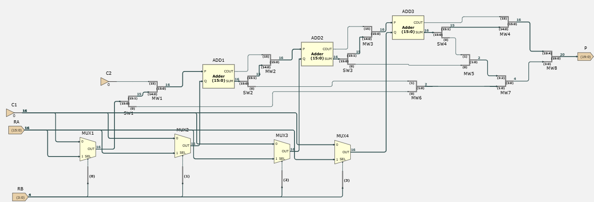

**Comments:**

- Each bit of Rb selects whether the output of the 2_MUX is 0 or Ra, depending on whether the bit is 0 or 1.
- The 16-bit adders sum the first 15 bits of the previous sum with Ra multiplied by a bit of Rb. As the bits of Rb go from bit 0 to bit 3, an extra 0 is added to Ra, making it 17 bits. To use the 16-bit adders, I modified the 17-bit output from the previous addition.
- I removed the LSB of the previous sum and made COUT the MSB of the number. This way, there's no need to add an extra 0 bit to Ra to achieve shifting. In the end, the most and least significant bits are merged together to form a 20-bit number.
- The basic design logic is shown in the hand-drawn annotation:

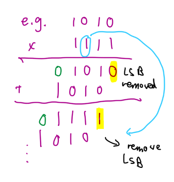

##### Sheet of `addpupl`

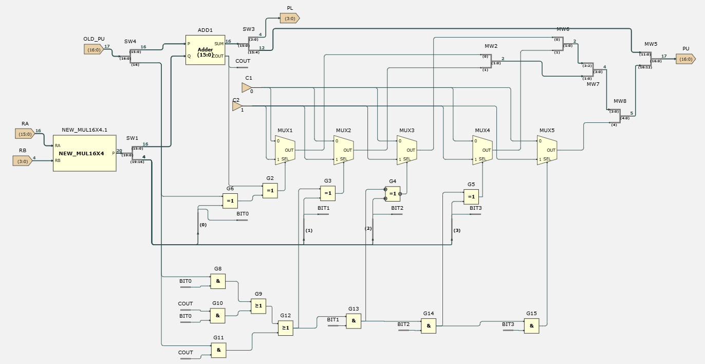

**Comments:**

- This sheet adds the product of the current 4 bits of Rb with Ra and the previous product of the less significant 4 bits of Rb with Ra. The sum is then split into a 17-bit upper product and a 4-bit lower product.
- The upper product is 17 bits because the COUT bit is combined with the upper 16 bits of SUM to account for cases where there is a carry out.

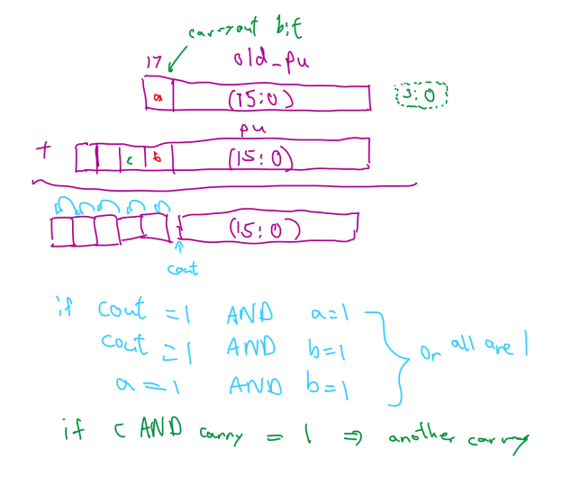

##### Sheet of `multiplier`

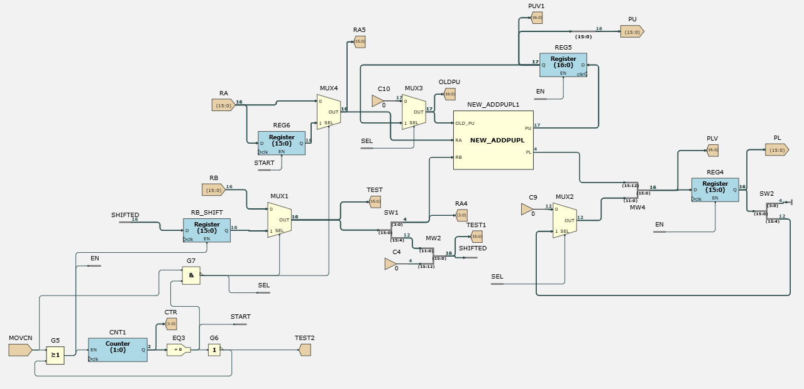

**Comments:**

**Logic**

The illustration below highlights the whole design logic:

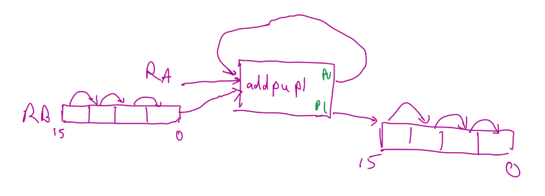

- The 16-bit Rb is input to a right-shift mechanism that keeps shifting the four 4-bit blocks of Rb, taking only the least significant block to be input into the `addpupl` sheet.
- The `addpupl` sheet has 3 inputs:
  1. The old PU
  2. Ra
  3. Rb
- The sheet outputs the upper 16 bits and lower 4 bits. The lower 4-bit PL is input into a mechanism that first combines it with the most significant 12 bits of the previous PL number, then shifts the number right by 4 bits until the operation is done.

**When `MOVCN = 1`**, `G5.output = 1`, so `RB_SHIFT`, `REG4`, `REG5`, `REG6` and the counter are enabled:

- The counter starts counting in the next clock cycle.
- The registers store the values, with the Q port being the value stored in the next clock cycle.

**When the `MOVCN` instruction is detected**, the counter is still at 0, so `MOVCN` ANDed with `EQ3` equals 1, making `G7.output = 0`:

- At the first clock cycle, the value used is the Rb value fed into the sheet.
- Afterwards, it is the value stored in `REG6`.
- `SEL` (which is `G7.output`) ensures that for `MUX1`, `MUX2`, `MUX3` and `MUX4` the initial value is correct.

---

#### 5.2.2 Adding to the datapath hardware

You can implement additional logic in and outputs from `DPDECODE` to control additional MUXes in the datapath. These MUXes can (only for the `MOVCn` instructions you decide to implement) select the output of your hardware block(s) instead of the ALU. You can put your hardware on a separate sheet which you add as a component to the datapath sheet.

Use hierarchy to simplify your hardware design (this will also speed up design and testing!). As an example, look at the shift block you are given as part of EEP1. Be creative: you do not have to follow the examples in the notes exactly. Reuse hardware whenever possible when two different and related operations need to be implemented.

##### Additional hardware in the datapath

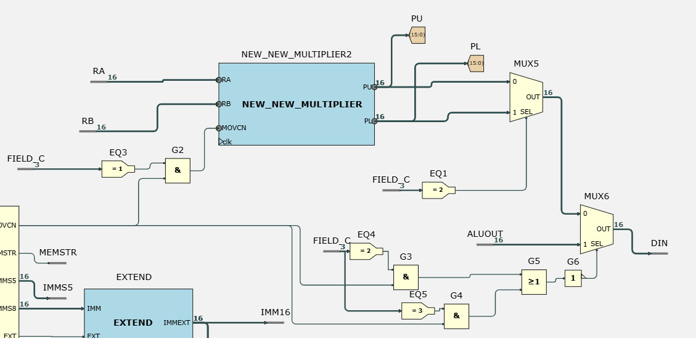

**Comments:**

When `c field = 1` and `MOVCN = 1`, `G2.output = 1` and the multiplier starts running. Once the multiplier has started, whether `MOVCN` is high no longer matters, as it is then controlled by the counter inside the multiplier.

##### Additional hardware in `dpdecode`

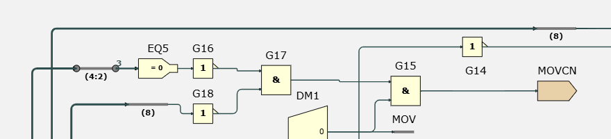

**Comments:**

`EQ5` detects whether the c field is 0 and whether bit 8 is 0 in the instruction:

- If bit 8 is 1, the c field is not 0 because of the immediate value in the instruction, so `MOVCN` cannot be 1.
- If we have a `MOV` instruction, bit 8 is not 1, and the c field is not empty, then `MOVCN = 1`.

---

#### 5.2.3 Using your new hardware

Try to work out optimal sequences of instructions. Consider whether slightly different hardware could speed up the software.

##### `lab2_challenge.ram`

```text
0x00 0x01cb
0x01 0x0364
0x02 0x0620
0x03 0x0880
0x04 0x0024
0x05 0x0024
0x06 0x0024
0x07 0x0024
0x08 0x0688
0x09 0x002c
```

##### `lab2_challenge_code1.txt`

```asm
MOV R0, #203
MOV R1, #100
MOV R3, R1
MOV R4, R0

MOVC1 R0, R1
MOVC1 R0, R1
MOVC1 R0, R1
MOVC1 R0, R1
MOVC2 R3, R4
MOVC3 R0, R1
```

##### Waveform simulation

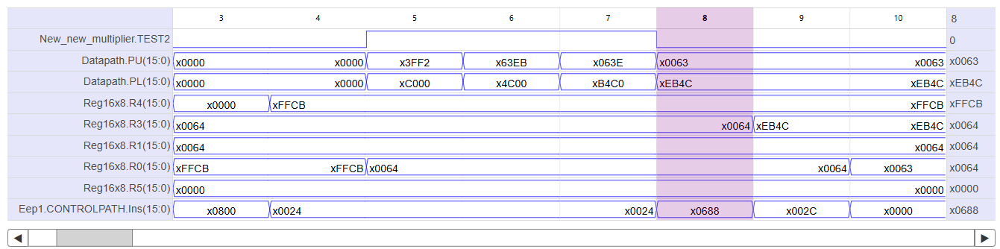

##### The input side of the multiplier sheet

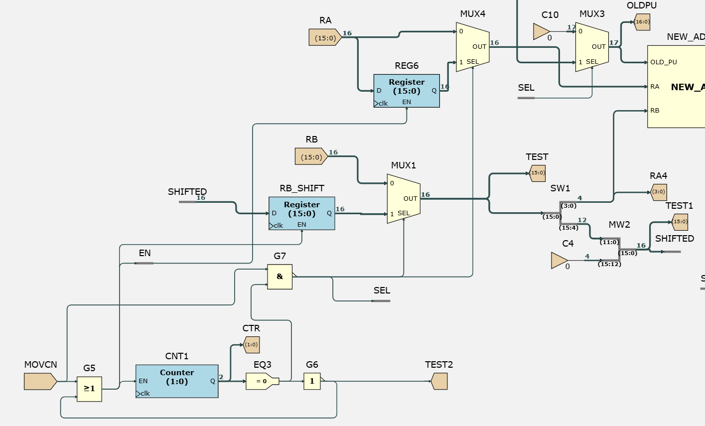

- When the CPU first executes the `MOVCN` instruction, `MOVCN = 1` at **clock cycle 4**. This enables the counter, making it start counting from 0.
- At the first clock cycle of the instruction, the counter value is 0, so `EQ3 = 1`. Hence `MOVCN` ANDed with `EQ3` is 1, making the `G7` output 0. This selects port 0 of `MUX1`. So at clock cycle 4, immediately when `MOVC1 R0, R1` is executed, the least significant 4 bits are shifted out in the same clock cycle, as shown by viewer `RA4`.
- At the same time, `MOVCN` is 1 and the counter value is not 0, so the register `RB_SHIFTED` (which stores the 16-bit right-shifted value of Rb) is enabled at clock cycle 4. At clock cycle 5, the register value is updated to `x0006`. Since `EQ3` is 0 (the counter is no longer at 0), the output of `G7` is 1 and port 1 (`RB_SHIFTED.Q`) is selected by `MUX1`.
- The multiplication runs for **4 clock cycles** (from clock cycle 5 to clock cycle 8). With the `.ram` file keeping the `MOVCN` signal high along with the instructions, at clock cycle 8 the counter value becomes 0 after counting 0 (cycle 4) → 1 (cycle 5) → 2 (cycle 6) → 3 (cycle 7). This makes `G7` output 0 at clock cycle 8.
- At clock cycle 8, the instruction `MOVC2 R3, R4` is executed, so through the additional datapath hardware, the PL value `xEB4C` is written to `R3`, which updates to `xEB4C` at clock cycle 9 in the waveform simulation.
- In the code, I used 4 `MOVC1` instructions as placeholders to ensure the CPU only writes the finished and correct values of PL and PU to registers when the `MOVC2` and `MOVC3` instructions are executed.

##### `lab2_challenge2.txt`

```asm
MOV R0, #203
MOV R1, #100
MOV R3, R1
MOV R4, R0

MOVC1 R0, R1
MOVC1 R0, R1
MOVC1 R0, R1
MOVC1 R0, R1
MOVC2 R3, R4
MOVC3 R0, R1

MOV R5, #5

EXT 0xA1
MOV R0, #23
MOV R1, #60
MOV R3, R1
MOV R4, R0

MOVC1 R0, R1
MOVC1 R0, R1
MOVC1 R0, R1
MOVC1 R0, R1
MOVC2 R3, R4
MOVC3 R0, R1
```

I also tested the code above and got the following waveform simulation:

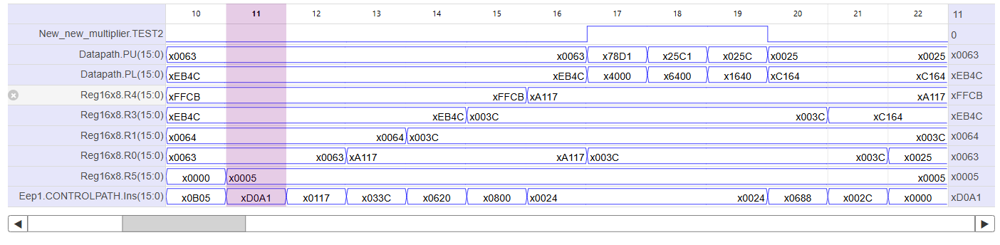

## Performance comparison

Cycle counts assume one cycle per instruction. Software versions include operand setup; the hardware figure includes operand loads.

| Version | Result width | Registers | Test case | Cycles | Worst case (R0 = 0xFFFF) |
|---|---|---|---|---|---|
| `mul1` – shift-and-add | 16-bit | 5 | 12 × 5 | 40 | 150 |
| `mul2` – shift-and-add, 32-bit | 32-bit (R6:R5) | 8 | 5 × 355 | 40 | 185 |
| `test_final` – MOVC1/2/3 | 32-bit (PU:PL) | 2–3 | 250 × 230 | 10 | 10 |

For 250 × 230 the software versions take 76 (`mul1`) and 93 (`mul2`) cycles, so the hardware is **7.6×** and **9.3×** faster respectively. In the worst case it is **15×** (`mul1`) and **18.5×** (`mul2`) faster.

Software time depends on the number of bits in the multiplier and on how many are set (an early exit when R0 reaches 0 helps small values). The hardware always takes 4 × `MOVC1` + `MOVC2` + `MOVC3`, independent of the operands.

**Caveat:** this compares cycles, not wall-clock time. The added adders may lengthen the critical path, which would reduce the real-time gain.

## Signed multiplication (software extension)

The hardware multiplies **unsigned** 16 × 16 → 32. The low word (PL) is identical for signed and unsigned operands, so only the high word (PU) needs correcting:

```
PU_signed = PU − (Rb if Ra < 0) − (Ra if Rb < 0)    (mod 2^16)
```

Example: `0xFFCB × 0x0064` (−53 × 100). Unsigned PU = `0x0063`; since Ra < 0, subtract Rb = `0x0064` to get `0xFFFF`, the correct signed high word for −5300 (`0xFFFF_EB4C`).

The multiplier uses exactly 64 full adders (3 × 16 in `mul_16x4`, 1 × 16 in `addpupl`), the full budget, so the correction is done in software: two sign tests and up to two `SUB` instructions after `MOVC3`.

## Conclusion

Overall, I managed to implement unsigned multiplication in fewer clock cycles than in Task 3 and 4 of Lab 2. However, from my simulations, my implementation can only handle **unsigned** number multiplication, so there is still room for improvement.

---

